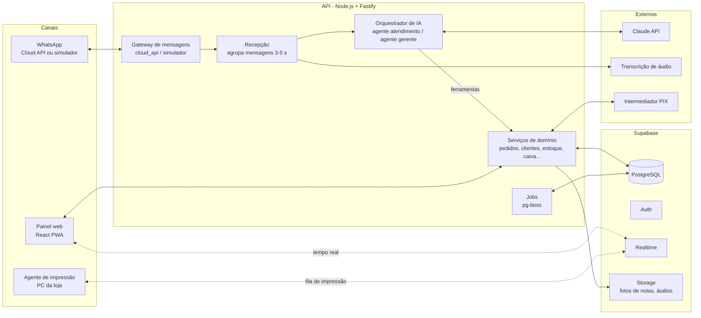
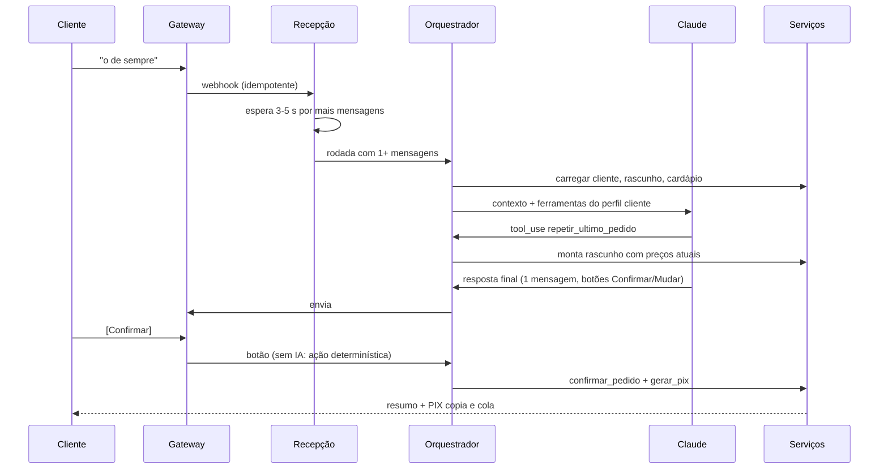

# Arquitetura técnica

22/10/2026 · issue [F0-07](https://github.com/carlosbarretoeng/claud.ia-food/issues/7) · decisões: [ADR-0003](decisoes/0003-ia-somente-por-ferramentas.md), [ADR-0004](decisoes/0004-gateway-de-mensagens-com-simulador.md), [ADR-0005](decisoes/0005-stack-typescript-supabase.md)

## Resumo

Um monorepo **TypeScript**: API em Node.js (Fastify), painel em React, simulador de WhatsApp e um agente de impressão local, sobre **PostgreSQL no Supabase** (banco, login, tempo real e arquivos) com a API em um contêiner. A IA usa a **API da Anthropic (Claude)** com ferramentas (tool use); o modelo só lê e altera dados por essas ferramentas. Custo estimado do MVP em produção: **~R$ 500–550/mês** para 500 pedidos/mês, com a IA dentro da meta de ≤ R$ 1,00 por pedido (RNF-13).

## 1. Componentes



| Componente           | Responsabilidade                                                                                                                                                                              | Requisitos principais          |
| -------------------- | --------------------------------------------------------------------------------------------------------------------------------------------------------------------------------------------- | ------------------------------ |
| Gateway de mensagens | Interface única de envio/recebimento; implementações `simulador` e `cloud_api`; valida assinatura dos webhooks; idempotência por ID da mensagem                                               | ADR-0004, RNF-06               |
| Recepção             | Enfileira cada mensagem, agrupa as do mesmo contato por 3–5 s, transcreve áudio, identifica se o remetente é cliente, equipe ou fornecedor                                                    | ATD-01, ATD-05, RNF-18         |
| Orquestrador de IA   | Monta o contexto (ficha do cliente, cardápio, rascunho do pedido), chama o Claude com as ferramentas do perfil, executa as ferramentas, envia **uma** resposta por rodada; escala para humano | ATD-_, GER-_, RNF-09           |
| Serviços de domínio  | Toda regra de negócio: preços, disponibilidade, taxas, status, estoque, caixa, permissões. Usados pela IA e pelo painel                                                                       | ADR-0003                       |
| Jobs (pg-boss)       | Tarefas agendadas e assíncronas no próprio Postgres: expiração de PIX, lembretes, resumo diário, reativação, segmentos                                                                        | FIN-03, GER-22, GER-43, CLI-06 |
| Painel               | Fila de pedidos, conversas (assumir/devolver), balcão, caixa, cardápio, estoque, relatórios, configuração                                                                                     | PED-_, ATD-12, REL-_           |
| Simulador            | Tela tipo WhatsApp para conversar como cliente/gerente/fornecedor; contador de mensagens por pedido                                                                                           | F0-08                          |
| Agente de impressão  | Programa pequeno no PC da loja; escuta a fila de impressão e imprime em ESC/POS na térmica                                                                                                    | PED-05                         |

## 2. Stack

| Camada          | Escolha                                                                                   | Motivo                                                                                                 |
| --------------- | ----------------------------------------------------------------------------------------- | ------------------------------------------------------------------------------------------------------ |
| Linguagem       | TypeScript 6.0 em tudo                                                                    | Um só idioma para API, painel, simulador e agente; tipos compartilhados (pedido, mensagem, ferramenta) |
| Monorepo        | pnpm workspaces                                                                           | Pacotes de domínio e mensageria reaproveitados por todos os apps                                       |
| API             | Node.js 24 LTS + Fastify + Zod                                                            | Leve, rápido, validação de entrada com os mesmos esquemas das ferramentas da IA                        |
| Banco           | PostgreSQL (Supabase) + Drizzle ORM                                                       | Relacional (pedidos, estoque, caixa), migrações versionadas                                            |
| Login e perfis  | Supabase Auth + Row Level Security                                                        | Perfis atendente, cozinha, gerente (RNF-07) sem construir autenticação                                 |
| Tempo real      | Supabase Realtime                                                                         | Fila de pedidos e cozinha atualizando sozinhas (PED-01)                                                |
| Arquivos        | Supabase Storage                                                                          | Fotos de notas, áudios, PDF do cardápio                                                                |
| Fila de jobs    | pg-boss (no próprio Postgres)                                                             | Sem Redis no MVP                                                                                       |
| Painel          | React + Vite + PWA                                                                        | Funciona em tablet, instalável, cache para queda de internet (RNF-05, v2)                              |
| IA              | `@anthropic-ai/sdk` (Claude API) com tool use                                             | Ferramentas tipadas com Zod; prompt caching                                                            |
| Transcrição     | API de transcrição em português (a escolher na implementação)                             | O Claude não recebe áudio; transcrição separada                                                        |
| PIX             | Intermediador escolhido na F0-02                                                          | Cobrança dinâmica + webhook                                                                            |
| Hospedagem      | Supabase (região São Paulo) + API em contêiner (Fly.io, região São Paulo)                 | Latência baixa e dados no Brasil                                                                       |
| Ambiente local  | Docker Compose: Node 24 + pnpm, Postgres, API, painel e simulador                         | Isolamento: nada instalado no computador além do Docker                                                |
| Testes          | Vitest (unidade), Playwright (ponta a ponta no simulador), bateria de conversas para a IA | RNF-17                                                                                                 |
| CI              | GitHub Actions                                                                            | Lint, tipos, testes a cada PR; bateria da IA quando prompts/ferramentas mudam                          |
| Observabilidade | Logs estruturados (pino) + Sentry                                                         | Erros e auditoria (RNF-12)                                                                             |

## 3. Estrutura do repositório

```
apps/
  api/              Fastify: webhooks, rotas do painel, orquestrador, jobs
  painel/           React PWA
  simulador/        Tela tipo WhatsApp (dev/testes)
  agente-impressao/ Serviço local ESC/POS
packages/
  dominio/          Entidades, regras e serviços (sem framework)
  mensageria/       Interface do gateway + cloud_api + simulador
  ia/               Agentes, prompts, ferramentas, bateria de testes
  db/               Esquema Drizzle e migrações
  config/           ESLint, tsconfig, utilitários
docs/               Requisitos, arquitetura, ADRs
```

## 4. Fluxo de um pedido



Respostas a botões (Confirmar, Mudar, PIX, Dinheiro) são tratadas **sem chamar a IA**, por regra determinística — mais barato, mais rápido e sem risco de interpretação.

## 5. Agentes de IA e ferramentas

Dois agentes, cada um com seu prompt e seu conjunto fechado de ferramentas. O perfil é decidido pelo telefone de quem escreve (equipe e fornecedores cadastrados; o resto é cliente).

| Agente                | Ferramentas                                                                                                                                                                                                                      | Observações                                                                                                                   |
| --------------------- | -------------------------------------------------------------------------------------------------------------------------------------------------------------------------------------------------------------------------------- | ----------------------------------------------------------------------------------------------------------------------------- |
| Atendimento (cliente) | `buscar_ficha_cliente`, `consultar_cardapio`, `repetir_ultimo_pedido`, `atualizar_rascunho`, `calcular_entrega`, `resumir_pedido`, `consultar_status_pedido`, `consultar_pontos`, `registrar_preferencia`, `escalar_para_humano` | Não tem ferramenta de desconto livre nem de alterar preço. Confirmação e PIX são acionados pelo botão do cliente, fora da IA. |
| Gerente virtual       | `ler_nota_fiscal` (imagem), `registrar_entrada`, `registrar_falta`, `registrar_reposicao`, `lista_de_compras`, `criar_lembrete`, `consultar_vendas`, `consultar_estoque`, `abrir_caixa`, `fechar_caixa`, `lancar_conta`          | Ações que alteram dados devolvem um resumo para "ok" quando há dúvida (GER-02); `consultar_*` só leem.                        |

Regras comuns:

- Ferramentas com `strict: true` (argumentos sempre válidos pelo esquema) e validação no servidor.
- Cardápio, regras da casa e prompt do agente ficam no início do contexto, estáveis, para aproveitar o **prompt caching**; dados variáveis (rascunho, mensagem nova) vão depois.
- Escopo restrito à loja (política da Meta para IA no WhatsApp); pergunta fora do escopo recebe recusa educada.
- Toda chamada de ferramenta é registrada com custo em tokens (REL-09, RNF-12).
- Tratamento de recusa do modelo (`stop_reason: "refusal"`) com fallback do servidor e, se ainda falhar, escalonamento para humano.

## 6. Modelo de IA e custo

**Escolha: `claude-opus-5-5`** (Claude Opus 5.5), com esforço `low` no atendimento e `medium` no gerente virtual; lê imagens (notas fiscais) no mesmo modelo.

| Modelo                                  | Entrada (US$/1M tokens) | Saída (US$/1M) | Leitura em cache (US$/1M) |
| --------------------------------------- | ----------------------- | -------------- | ------------------------- |
| Claude Opus 5.5 (`claude-opus-5-5`)     | 4,00                    | 20,00          | 0,20                      |
| Claude Sonnet 5.5 (`claude-sonnet-5-5`) | 2,00                    | 10,00          | 0,20                      |
| Claude Haiku 5.5 (`claude-haiku-5-5`)   | 0,10                    | 0,50           | —                         |

Estimativa (ordem de grandeza, a medir no MVP): cada rodada de conversa ≈ 5 mil tokens em cache (prompt + cardápio + ferramentas) + 1 mil tokens novos + ~600 de saída; um pedido recorrente ≈ 4 rodadas.

| Item                              | Opus 5.5             | Sonnet 5.5            |
| --------------------------------- | -------------------- | --------------------- |
| Custo por rodada                  | ~US$ 0,017           | ~US$ 0,009            |
| Custo por pedido (4 rodadas)      | ~US$ 0,07 (~R$ 0,38) | ~US$ 0,036 (~R$ 0,20) |
| 500 pedidos/mês + gerente virtual | ~US$ 45 (~R$ 250)    | ~US$ 23 (~R$ 125)     |

Câmbio assumido: R$ 5,50/US$. Com o WhatsApp (~R$ 0,14 por pedido no fluxo enxuto), o Opus 5.5 fica em ~R$ 0,52 por pedido, dentro da meta de ≤ R$ 1,00 (RNF-13). Trocar de modelo é uma configuração; a decisão de usar um modelo mais barato fica para depois de medir qualidade com a bateria de conversas.

## 7. Custo mensal do MVP em produção (estimativa)

| Item                  | Custo/mês        | Observação                                                            |
| --------------------- | ---------------- | --------------------------------------------------------------------- |
| Claude API            | ~R$ 250          | 500 pedidos + gerente virtual (seção 6)                               |
| WhatsApp Cloud API    | ~R$ 70           | Fluxo enxuto, RNF-18                                                  |
| Supabase (plano pago) | ~R$ 140 (US$ 25) | O plano grátis pausa projetos inativos; serve só para desenvolvimento |
| Contêiner da API      | ~R$ 30–60        | Uma máquina pequena                                                   |
| Transcrição de áudio  | ~R$ 10–30        | Depende do volume de áudios                                           |
| Taxas PIX             | Variável         | Depende do intermediador (F0-02)                                      |
| **Total**             | **~R$ 500–550**  | Sem taxas PIX                                                         |

Preços de Supabase, hospedagem e transcrição são aproximados e devem ser conferidos na contratação. Em desenvolvimento, com simulador e planos grátis, o custo é praticamente só o da Claude API nos testes.

## 8. Ambientes

| Ambiente    | Mensageria                          | Banco                                                                                                                                  | Uso                                                  |
| ----------- | ----------------------------------- | -------------------------------------------------------------------------------------------------------------------------------------- | ---------------------------------------------------- |
| Local       | Simulador                           | Supabase do homelab (Postgres 17, Auth, Realtime, Storage), acessado pela Tailscale; Postgres local opcional (`--profile banco-local`) | Desenvolvimento, apps em containers (`compose.yaml`) |
| Homologação | Simulador e número de teste da Meta | Supabase do homelab                                                                                                                    | Testes ponta a ponta, demonstrações                  |
| Produção    | Cloud API (número oficial)          | Projeto Supabase pago, região São Paulo                                                                                                | Loja                                                 |

## 9. Segurança e segredos

- Repositório público: nenhuma chave no código ([SECURITY.md](../SECURITY.md)). Segredos em variáveis de ambiente da hospedagem; localmente em `.env` (ignorado pelo git) a partir de um `.env.example` com valores fictícios.
- Webhooks da Meta e do PIX validados por assinatura; rotas do painel exigem login com perfil.
- Row Level Security no Postgres por perfil; a API usa a chave de serviço apenas no servidor.
- Dados enviados à IA: só o necessário para a conversa (nome, histórico de pedidos, preferências), nunca dados de pagamento.

## 10. Testes da IA

- Bateria de regressão com as conversas reais anonimizadas da F0-05 (≥ 100), rodada no simulador.
- Cada caso verifica: pedido final correto (itens, adicionais, total), número de mensagens enviadas (RNF-18), escalonamento quando esperado, nenhuma ferramenta proibida chamada.
- Roda no CI quando prompts, ferramentas ou o modelo mudam, com limite de custo por execução.

## 11. Próximos passos

1. Revisar e aprovar este documento e o ADR-0005.
2. Criar o esqueleto do monorepo (apps, pacotes, CI) e o esquema inicial do banco.
3. Implementar o simulador (F0-08) e o gateway de mensagens.
4. Primeira fatia vertical: cliente pede "o de sempre" no simulador → pedido confirmado aparece no painel.
