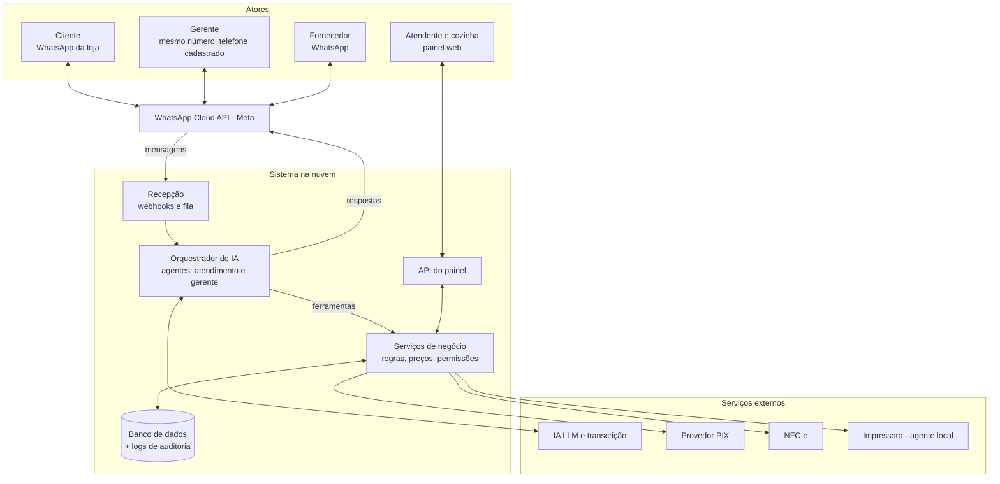

# Requisitos — sistema de atendimento e gestão para lanchonete via WhatsApp

22/10/2026 · Carlos Barreto · versão viva: [Claude Docs](https://claude.ai/artifact/DV2kG1BVW4VRzEahjZiCEp)

## 1. Visão geral

O sistema atende clientes de uma lanchonete/hamburgueria pequena pelo WhatsApp, numa conversa direcionada pelo histórico de cada cliente, e dá ao gerente um assistente virtual no mesmo canal para estoque, compras, caixa e financeiro.

**Objetivos**

1. Vender mais por cliente com atendimento personalizado: repetir o pedido habitual, sugerir com base no histórico, reativar quem sumiu.
2. Atender 24 horas e aguentar o pico sem perder pedido, com IA que conversa e humano que assume quando precisa.
3. Tirar o trabalho manual do gerente: entrada de mercadoria por foto/áudio, baixa de estoque automática, lista de compras e lembretes.
4. Operar salão, balcão e delivery numa fila única de pedidos, com cozinha e entrega integradas.

**Premissas**

- Operação de pequeno porte: 1 loja, 1 a 3 atendentes, até \~500 pedidos/mês, maioria delivery.
- WhatsApp é o canal principal, tanto para clientes quanto para a equipe interna.
- O pedido é feito **na conversa**; não há cardápio digital com carrinho como caminho principal (uma foto ou PDF do cardápio pode ser enviada quando o cliente pedir).
- Atendimento híbrido: a IA atende, monta o pedido e escala para um humano; o humano pode assumir qualquer conversa a qualquer momento.
- Uso do número oficial via API do WhatsApp (Cloud API da Meta), para evitar banimento por automação.

**Fora de escopo nesta versão**

- Integração com iFood e outros marketplaces.
- Cardápio digital com carrinho e checkout.
- Múltiplas lojas / franquias.
- Compra automática sem aprovação humana (prevista para fase futura).

**Convenções deste documento**

- IDs: `ATD` atendimento, `PED` pedidos, `CLI` clientes, `GER` gerente virtual, `FIN` pagamentos/fiscal, `REL` relatórios, `RNF` não funcionais.
- Prioridade: **MVP** (sem isso não entra em produção) · **v2** (logo após estabilizar) · **v3** (futuro).

## 2. Atores e canais

Seis atores usam o sistema por três canais: o WhatsApp da loja (clientes), o WhatsApp interno (gerente) e um painel web (atendentes, cozinha, caixa).

| Ator | O que faz | Canal | Permissões principais |
| --- | --- | --- | --- |
| Cliente | Pede, paga, acompanha o pedido, recebe ofertas | WhatsApp da loja | Apenas os próprios dados e pedidos |
| Assistente de atendimento (IA) | Conversa com o cliente, monta o pedido, sugere, cobra, escala | Interno (motor do sistema) | Ler cardápio, clientes e pedidos; criar pedidos pendentes de confirmação |
| Atendente | Supervisiona a IA, assume conversas, confirma pedidos, atende balcão e salão | Painel web (desktop ou tablet) | Clientes, pedidos, conversas; sem financeiro |
| Cozinha | Recebe e prepara pedidos, marca como pronto | Tela de cozinha (KDS) ou impressora | Apenas fila de produção |
| Entregador | Recebe rota e endereço, marca saída e entrega | Link no WhatsApp ou painel simplificado | Apenas pedidos atribuídos a ele |
| Gerente / dono | Estoque, compras, caixa, financeiro, relatórios, configuração | mesmo WhatsApp da loja, reconhecido pelo telefone cadastrado (assistente virtual) + painel web | Tudo |

O assistente do gerente só responde a números cadastrados como equipe; mensagens de outros números nunca acessam funções internas.

## 3. Módulo 1 — Atendimento conversacional ao cliente

A IA atende cada cliente pelo nome, com o histórico dele à mão, monta o pedido na conversa e só envia para a cozinha depois da confirmação explícita do cliente.

**Fluxo típico**

1. Cliente manda mensagem; o sistema identifica pelo telefone e carrega ficha, preferências e últimos pedidos.
2. IA cumprimenta pelo nome e oferece o pedido habitual ("O de sempre? X-bacon sem cebola + batata média") ou pergunta o que deseja.
3. Cliente pede em texto livre ou áudio; IA interpreta itens, adicionais e observações, e pergunta o que faltar (ponto da carne, tamanho, bebida).
4. IA faz no máximo uma sugestão relevante (combo, adicional, novidade compatível com o histórico).
5. IA confirma entrega ou retirada, endereço (salvo ou novo), taxa e tempo estimado.
6. IA envia o resumo com total; cliente responde "confirmo" (ou botão).
7. IA envia a cobrança (PIX/link) ou registra pagamento na entrega; pedido vai para a fila da cozinha.
8. Cliente recebe avisos de status até a entrega.

**Requisitos**

| ID | Requisito | Prioridade | Critério de aceite |
| --- | --- | --- | --- |
| ATD-01 | Receber e responder mensagens de texto do WhatsApp oficial da loja | MVP | Resposta automática em até 5 s em 95% das mensagens |
| ATD-02 | Identificar o cliente pelo telefone e carregar ficha e histórico antes de responder | MVP | Cliente recorrente é chamado pelo nome e recebe oferta do pedido habitual |
| ATD-03 | Cadastrar cliente novo na conversa (nome, endereço) sem formulário | MVP | Ficha criada ao fim do primeiro pedido, com consentimento LGPD registrado |
| ATD-04 | Interpretar pedido em linguagem natural: itens, quantidades, adicionais, remoções, observações | MVP | Pedido montado corretamente em ≥ 95% dos casos de teste do cardápio real |
| ATD-05 | Transcrever áudios do cliente e tratá-los como texto | MVP | Áudio de até 60 s transcrito e respondido em até 15 s |
| ATD-06 | Validar o pedido contra o cardápio: só itens existentes, disponíveis e com preço vigente; a IA nunca inventa item ou preço | MVP | Item inexistente ou esgotado gera resposta com alternativa, nunca entra no pedido |
| ATD-07 | Repetir pedido anterior com um comando ("o de sempre", "igual ao último") | MVP | Pedido habitual montado com preços atuais e confirmado em uma mensagem |
| ATD-08 | Sugestão direcionada: no máximo 1 por pedido, baseada em histórico, horário e itens em destaque | v2 | Taxa de aceite de sugestões medida no relatório REL-05 |
| ATD-09 | Calcular taxa de entrega por bairro (tabela fixa) e informar tempo estimado conforme a fila atual | MVP | Taxa e prazo exibidos antes do resumo final |
| ATD-10 | Enviar resumo do pedido e exigir confirmação explícita antes de enviar à cozinha | MVP | Nenhum pedido entra na fila sem confirmação registrada |
| ATD-11 | Escalonar para humano: por pedido do cliente, baixa confiança da IA, reclamação, ou 2 mal-entendidos seguidos | MVP | Atendente notificado no painel em até 5 s; IA para de responder naquela conversa |
| ATD-12 | Atendente pode assumir e devolver qualquer conversa para a IA | MVP | Botão "assumir" / "devolver" no painel; histórico preservado |
| ATD-13 | Modo "aprovação": IA monta o pedido e o atendente aprova antes de confirmar ao cliente (configurável) | MVP | Atendente aprova cada pedido até a IA acertar ≥ 95% dos pedidos por 2 semanas seguidas (medido em REL-03); então é desligado |
| ATD-14 | Responder perguntas frequentes: horário, endereço, área de entrega, formas de pagamento, ingredientes e alergênicos | MVP | Respostas vêm da base de configuração, não de suposição da IA |
| ATD-15 | Enviar foto ou PDF do cardápio quando o cliente pedir | MVP | Envio do arquivo vigente configurado pelo gerente |
| ATD-16 | Avisos de status: confirmado, em preparo, saiu para entrega (com nome do entregador), entregue | MVP | Mensagens enviadas na mudança de status, dentro da janela de 24 h |
| ATD-17 | Fora do horário: informar horário e permitir pedido agendado | v2 | Pedido agendado entra na fila no horário escolhido |
| ATD-18 | Alterar ou cancelar pedido pela conversa enquanto não entrou em preparo | MVP | Após "em preparo", pedido de alteração escala para humano |
| ATD-19 | Personalidade configurável: nome do assistente, tom, emojis, frases da casa | v2 | Configuração no painel aplicada sem novo deploy |
| ATD-20 | Entender imagens enviadas pelo cliente (ex.: print de pedido antigo, comprovante PIX) | v3 | Comprovante PIX vinculado ao pedido para conferência |

**Regras de comportamento da IA**

- Escopo restrito à loja: pedidos, cardápio, entrega, pagamentos e dúvidas da casa. Assuntos fora disso recebem resposta educada de recusa (a política da Meta proíbe assistente de IA de uso geral no WhatsApp Business; atendimento ao cliente é permitido).
- Preços, itens, disponibilidade e taxas sempre vêm do banco de dados via ferramentas (function calling), nunca da memória do modelo.
- Descontos e cupons só dentro das regras configuradas; a IA não concede desconto por conta própria.
- Toda conversa e decisão da IA fica registrada para auditoria e melhoria.

## 4. Módulo 2 — Pedidos e operação

Todos os pedidos — WhatsApp, balcão e salão — entram numa fila única, seguem os mesmos status e alimentam cozinha, entrega, estoque e caixa.

**Status do pedido:** Rascunho (em conversa) → Aguardando confirmação → Confirmado → Em preparo → Pronto → Saiu para entrega / Aguardando retirada / Servido → Entregue (Concluído). Cancelado pode ocorrer até "Em preparo"; depois disso exige gerente.

| ID | Requisito | Prioridade | Critério de aceite |
| --- | --- | --- | --- |
| PED-01 | Fila única de pedidos no painel, com origem (WhatsApp, balcão, mesa), status, tempo decorrido e tipo (entrega, retirada, consumo local) | MVP | Pedido novo aparece em até 2 s, com alerta sonoro |
| PED-02 | Lançar pedido manual de balcão e mesa no painel (busca rápida de itens, adicionais, observações) | MVP | Pedido de 3 itens lançado em menos de 30 s |
| PED-03 | Vincular pedido de balcão/mesa a um cliente pelo telefone, para alimentar o histórico | v2 | Histórico do cliente mostra pedidos de todos os canais |
| PED-04 | Mesas e comandas: abrir, adicionar itens em rodadas, transferir, juntar, dividir conta, fechar | v2 | Conta dividida por pessoa ou por item |
| PED-05 | Impressão automática na cozinha ao confirmar (impressora térmica 80 mm) | MVP | Comanda impressa em até 5 s, com observações destacadas |
| PED-06 | Tela de cozinha (KDS) com fila por ordem de entrada, cronômetro e botão "pronto" | v2 | Pedido acima do tempo-alvo fica em vermelho |
| PED-07 | Separar itens por estação de produção (chapa, fritura, bebidas) | v3 | Cada estação vê só seus itens |
| PED-08 | Pausar item esgotado com um clique; a IA deixa de oferecê-lo imediatamente | MVP | Item pausado não entra em nenhum pedido novo |
| PED-09 | Tempo de preparo estimado dinâmico, com base na fila atual | v2 | Estimativa informada ao cliente com erro médio < 10 min |
| PED-10 | Atribuir entregador ao pedido; agrupar entregas próximas | MVP (atribuir) / v2 (agrupar) | Entregador recebe no WhatsApp: endereço, link do mapa, valor a cobrar, troco |
| PED-11 | Entregador marca "saiu" e "entregue" por link ou resposta no WhatsApp | MVP | Status atualizado e cliente avisado automaticamente |
| PED-12 | Acerto de entregadores no fim do turno: quantidade de entregas, taxas, valores recebidos em dinheiro | v2 | Relatório por entregador fecha com o caixa |
| PED-13 | Horário de funcionamento, pausa do delivery e limite de pedidos simultâneos | MVP | Com delivery pausado, a IA informa e oferece retirada |
| PED-14 | Cancelamento com motivo obrigatório e estorno do estoque | MVP | Cancelamentos listados com motivo no relatório |

**Cardápio (cadastro interno, não exposto como cardápio digital)**

| ID | Requisito | Prioridade | Critério de aceite |
| --- | --- | --- | --- |
| PED-20 | Cadastro de categorias, itens, preço, descrição, ingredientes e alergênicos | MVP | IA responde ingredientes a partir do cadastro |
| PED-21 | Grupos de adicionais e remoções com preço (ex.: +bacon R$ 4, sem cebola) e mín./máx. por grupo | MVP | Pedido fora da regra (ex.: 3 molhos onde o máx. é 2) é recusado com explicação |
| PED-22 | Combos com itens escolhíveis e preço promocional | MVP | Combo calculado corretamente com trocas permitidas |
| PED-23 | Sinônimos e apelidos por item ("x-bacon", "xis bacon", "o de bacon") para melhorar o entendimento da IA | MVP | Sinônimos cadastráveis no painel |
| PED-24 | Ficha técnica por item (insumos e quantidades) para baixa de estoque | MVP | Ver GER-10 |
| PED-25 | Promoções por dia/horário (ex.: terça do smash) | v2 | Preço promocional aplicado só na janela configurada |

## 5. Módulo 3 — Clientes e relacionamento

A ficha de cada cliente é o que torna o atendimento direcionado: ela se monta sozinha a partir dos pedidos e conversas, e alimenta sugestões, fidelidade e campanhas.

| ID | Requisito | Prioridade | Critério de aceite |
| --- | --- | --- | --- |
| CLI-01 | Ficha do cliente: nome, telefone, endereços (vários, com apelido "casa", "trabalho"), data do 1º pedido, consentimentos | MVP | Ficha visível ao lado da conversa no painel |
| CLI-02 | Histórico completo de pedidos e conversas, de todos os canais | MVP | Últimos 10 pedidos acessíveis em um clique |
| CLI-03 | Preferências extraídas automaticamente ("sempre sem cebola", "carne ao ponto", "paga no PIX") e editáveis pelo atendente | MVP (manual) / v2 (automático) | Preferência aplicada ao montar o pedido, sempre confirmada no resumo |
| CLI-04 | Pedido habitual calculado (combinação mais frequente nos últimos 90 dias) | MVP | Oferecido pela IA na saudação de clientes recorrentes |
| CLI-05 | Indicadores por cliente: frequência, ticket médio, total gasto, dias desde o último pedido | v2 | Exibidos na ficha |
| CLI-06 | Segmentos automáticos: novos, frequentes, VIP, em risco (> 2× o intervalo habitual sem pedir), inativos (> 45 dias) | v2 | Segmentos recalculados diariamente |
| CLI-07 | Programa de fidelidade: pontos por real gasto, trocados por itens do cardápio, informado pela IA na conversa | v2 | Saldo consultado por "quantos pontos eu tenho?" |
| CLI-08 | Cupons com regras: validade, valor mínimo, uso único, segmento | v2 | Cupom inválido recusado com o motivo |
| CLI-09 | Campanhas por WhatsApp para segmentos, com modelos aprovados pela Meta e agendamento | v2 | Envio só para quem aceitou receber ofertas; custo estimado exibido antes do envio |
| CLI-10 | Reativação automática: mensagem com oferta para clientes "em risco", no máximo 1 por mês por cliente | v2 | Retorno medido em REL-06 |
| CLI-11 | Pesquisa de satisfação após a entrega (nota 1–5 + comentário); nota ≤ 3 alerta o gerente | v2 | Alerta chega ao gerente no WhatsApp em até 1 min |
| CLI-12 | Aniversariantes: oferta automática no mês do aniversário (se o cliente informou a data) | v3 | Mensagem enviada no dia configurado |
| CLI-13 | Descadastro: cliente responde "sair" e para de receber ofertas imediatamente | MVP | Opt-out registrado e respeitado em todas as campanhas |
| CLI-14 | Exportar e excluir dados do cliente a pedido (LGPD) | MVP | Exclusão anonimiza a ficha e preserva os números financeiros |

## 6. Módulo 4 — Gerente virtual

O gerente conversa com o sistema pelo WhatsApp (texto, áudio ou foto) para lançar entradas, avisar faltas, montar compras e consultar números; toda ação que altera dados é resumida e só executada após "ok".

**Exemplos de conversa**

- "Chegou a entrega do açougue" + foto da nota → "Li 3 itens: blend 10 kg (R$ 42/kg), bacon 3 kg (R$ 38/kg), costela 5 kg (R$ 36/kg). Total R$ 714, boleto vence 05/11. Confirmo a entrada e a conta a pagar?"
- "Acabou o cheddar" → "Pausei os 4 itens com cheddar no atendimento e coloquei cheddar na lista de compras do Laticínios São José (último preço R$ 54/kg). Quer que eu lembre amanhã às 9h?"
- "Quanto vendi de batata essa semana?" → resposta com números do banco.

**Estoque**

| ID | Requisito | Prioridade | Critério de aceite |
| --- | --- | --- | --- |
| GER-01 | Cadastro de insumos: unidade (kg, un, L), estoque mínimo, fornecedor preferencial, custo médio | MVP | Insumo usado em fichas técnicas e compras |
| GER-02 | Entrada de mercadoria por foto da nota/cupom/canhoto: IA extrai itens, quantidades, valores e vencimento | MVP | Gerente confirma ou corrige antes de gravar; itens desconhecidos são associados a insumos (associação lembrada para a próxima vez) |
| GER-03 | Entrada por chave de acesso da NF-e (44 dígitos ou foto do código de barras) importando o XML | v2 | Itens e valores importados sem digitação |
| GER-04 | Entrada por áudio ou texto ("chegaram 5 pacotes de pão brioche") | MVP | Mesmo fluxo de confirmação do GER-02 |
| GER-05 | Aviso de falta ("acabou X"): zera ou ajusta o insumo, pausa os itens dependentes no atendimento e inclui na lista de compras | MVP | Itens pausados em até 10 s; gerente recebe a lista do que foi pausado |
| GER-06 | Reposição ("chegou cheddar") reativa automaticamente os itens pausados por falta | MVP | Itens voltam ao atendimento após confirmação |
| GER-07 | Baixa automática de insumos a cada pedido concluído, pela ficha técnica (incluindo adicionais e remoções) | MVP | Estoque teórico atualizado em tempo real |
| GER-08 | Contagem de inventário guiada pelo WhatsApp ("vamos contar a câmara fria": o sistema pergunta item a item) | v2 | Diferenças entre teórico e físico registradas como perda ou ajuste |
| GER-09 | Registro de perdas e desperdício com motivo (vencido, queimado, erro de pedido) | v2 | Perdas no relatório de CMV |
| GER-10 | Ficha técnica por item do cardápio, com custo calculado e margem | MVP (insumos) / v2 (custo e margem) | Custo do X-bacon atualizado quando o preço do blend muda |
| GER-11 | Controle de validade por lote para perecíveis | v3 | Alerta 2 dias antes do vencimento |

**Compras**

| ID | Requisito | Prioridade | Critério de aceite |
| --- | --- | --- | --- |
| GER-20 | Cadastro de fornecedores: contato WhatsApp, itens, prazo de entrega, dias de pedido, pedido mínimo | MVP | Fornecedor vinculado aos insumos |
| GER-21 | Lista de compras automática, agrupada por fornecedor, alimentada por faltas e por estoque abaixo do mínimo | MVP | Lista consultável por "o que preciso comprar?" |
| GER-22 | Lembretes de compra: horário, dia de pedido do fornecedor ou "me lembra amanhã cedo" | MVP | Lembrete chega no WhatsApp do gerente no horário |
| GER-23 | Previsão de consumo: "o blend dura 2 dias no ritmo atual", com base na média de vendas por dia da semana | v2 | Alerta antecipado considerando prazo do fornecedor |
| GER-24 | Sugestão de quantidade a comprar (consumo previsto até a próxima entrega + estoque de segurança) | v2 | Quantidade sugerida editável antes do envio |
| GER-25 | Gerar pedido de compra e enviar ao fornecedor pelo WhatsApp após "aprovado" do gerente | v2 | Mensagem enviada com itens, quantidades e data desejada; registro do pedido em aberto |
| GER-26 | Conferir recebimento contra o pedido de compra (faltas, divergência de preço) | v2 | Divergências destacadas na confirmação da entrada |
| GER-27 | Histórico e comparação de preços por insumo e fornecedor | v2 | "Qual fornecedor de pão está mais barato?" respondido com dados |
| GER-28 | Compra automática: pedidos recorrentes enviados sem aprovação, dentro de limites de valor e itens definidos pelo gerente | v3 | Limite por pedido e por mês; resumo enviado ao gerente após cada compra |

**Financeiro e caixa**

| ID | Requisito | Prioridade | Critério de aceite |
| --- | --- | --- | --- |
| GER-40 | Abertura e fechamento de caixa (fundo de troco, sangria, reforço), pelo painel ou WhatsApp | MVP | Fechamento mostra esperado x contado por forma de pagamento |
| GER-41 | Contas a pagar a partir das entradas (boleto, vencimento) e lançamento manual ("paguei a luz, R$ 480") | MVP | Lembrete na véspera do vencimento |
| GER-42 | Contas a receber de cartão/PIX com taxas e prazo de repasse | v2 | Conciliação com o extrato do provedor de pagamento |
| GER-43 | Resumo diário automático ao fechar a loja: vendas, ticket médio, pedidos por canal, itens em falta, contas do dia seguinte | MVP | Mensagem enviada até 15 min após o fechamento |
| GER-44 | Fluxo de caixa e DRE simplificado (receita, CMV, despesas, resultado) | v3 | Relatório mensal exportado em PDF/planilha |

**Perguntas livres ao assistente:** consultas em linguagem natural sobre vendas, estoque, clientes e financeiro, respondidas sempre por consultas ao banco (nunca estimativa do modelo), com o período considerado explicitado na resposta (GER-50, MVP para vendas e estoque).

## 7. Módulo 5 — Pagamentos e fiscal

O PIX com confirmação automática entra no MVP; cartão online e NFC-e vêm por provedores externos via API, sem o sistema guardar dados de cartão.

| ID | Requisito | Prioridade | Critério de aceite |
| --- | --- | --- | --- |
| FIN-01 | Gerar cobrança PIX dinâmica (copia e cola + QR) por pedido, via API de um provedor de pagamento | MVP | Código enviado na conversa logo após a confirmação |
| FIN-02 | Confirmar pagamento PIX automaticamente (webhook) e liberar o pedido para a cozinha | MVP | Pedido muda para "pago" em até 10 s após o pagamento; cliente recebe confirmação |
| FIN-03 | Expiração do PIX (ex.: 15 min) com lembrete e cancelamento do pedido não pago | MVP | Prazo configurável |
| FIN-04 | Pagamento na entrega/retirada: dinheiro (com troco informado), cartão na maquininha | MVP | Troco e forma de pagamento aparecem na comanda e na mensagem do entregador |
| FIN-05 | Link de pagamento por cartão de crédito/débito do provedor | v2 | Nenhum dado de cartão trafega ou é armazenado no sistema |
| FIN-06 | Estorno total ou parcial de PIX/cartão em cancelamento, com aprovação do gerente | v2 | Estorno registrado no pedido e no caixa |
| FIN-07 | Emissão de NFC-e por pedido, via API de emissor fiscal (certificado A1 e CSC da loja configurados) | v2 (verificar obrigatoriedade) | Cupom autorizado pela SEFAZ e link/arquivo enviado ao cliente no WhatsApp |
| FIN-08 | Cancelamento de NFC-e dentro do prazo legal e contingência offline | v2 | Notas em contingência transmitidas automaticamente quando a SEFAZ volta |
| FIN-09 | Envio automático mensal dos XMLs ao contador | v2 | E-mail ou pasta compartilhada com os arquivos do mês |
| FIN-10 | Integração com maquininha (POS/TEF) para eliminar digitação de valor | v3 | Valor enviado do painel para a maquininha |

A obrigatoriedade de NFC-e depende do regime tributário (MEI, Simples Nacional) e do estado; validar com o contador antes de definir se FIN-07 sobe para o MVP.

## 8. Módulo 6 — Relatórios e painel

Os relatórios ficam no painel web e os principais números também chegam ao gerente pelo WhatsApp (GER-43, GER-50).

| ID | Relatório / indicador | Prioridade | Detalhe |
| --- | --- | --- | --- |
| REL-01 | Vendas por dia, hora e dia da semana; ticket médio; nº de pedidos | MVP | Filtro por período e por canal (WhatsApp, balcão, mesa) e tipo (entrega, retirada, local) |
| REL-02 | Itens mais e menos vendidos; adicionais mais pedidos | MVP | Quantidade e receita por item |
| REL-03 | Desempenho do atendimento: tempo de primeira resposta, % de pedidos fechados só pela IA, % escalados, motivos de escalonamento | MVP | Base para ajustar a IA |
| REL-04 | Conversão: conversas iniciadas → pedidos confirmados → pagos | v2 | Mostra onde os clientes desistem |
| REL-05 | Sugestões da IA: oferecidas, aceitas, receita gerada | v2 | Mede o valor da venda direcionada |
| REL-06 | Clientes: novos x recorrentes, frequência, segmentos, retorno de campanhas e reativações | v2 | Receita atribuída por campanha |
| REL-07 | Operação: tempo médio de preparo e entrega, atrasos, cancelamentos com motivo | v2 | Por faixa de horário |
| REL-08 | Estoque e CMV: consumo teórico x real, perdas, custo por item e margem | v2 | Depende de GER-07 a GER-10 |
| REL-09 | Custo de operação do sistema: mensagens WhatsApp pagas e consumo de IA no mês | MVP | Evita surpresa na conta da Meta e da IA |
| REL-10 | Exportação em planilha (CSV/XLSX) de qualquer relatório | MVP |  |

## 9. Requisitos não funcionais

O sistema precisa responder rápido no pico do jantar, não perder pedido se a IA ou a internet falharem, e custar pouco por pedido.

| ID | Categoria | Requisito | Meta |
| --- | --- | --- | --- |
| RNF-01 | Desempenho | Tempo de resposta da IA ao cliente | p95 ≤ 5 s (texto), ≤ 15 s (áudio) |
| RNF-02 | Desempenho | Capacidade no pico | 10 conversas simultâneas e 20 pedidos/hora sem degradação (2× o pico estimado) |
| RNF-03 | Disponibilidade | Recepção de mensagens e pedidos | 99,5% no horário de funcionamento |
| RNF-04 | Resiliência | Falha da IA (provedor fora do ar ou lento) | Mensagens vão para a fila humana com alerta; nenhuma mensagem perdida |
| RNF-05 | Resiliência | Queda de internet na loja | Painel mantém fila e lançamento de balcão offline e sincroniza ao voltar (v2); o atendimento WhatsApp segue na nuvem |
| RNF-06 | Resiliência | Webhooks (WhatsApp, PIX) | Processamento idempotente e com fila de reprocessamento; nenhum pedido ou pagamento duplicado |
| RNF-07 | Segurança | Acesso ao painel | Login por usuário com perfil (atendente, cozinha, gerente); 2FA para gerente |
| RNF-08 | Segurança | Assistente do gerente | Só responde a números cadastrados; ações financeiras exigem confirmação explícita |
| RNF-09 | Segurança | Proteção contra manipulação da IA (prompt injection) | Preços, descontos e status só mudam por regras do backend; a IA só chama ferramentas permitidas ao perfil daquela conversa |
| RNF-10 | Privacidade (LGPD) | Dados pessoais | Base legal registrada; opt-in para marketing; exportação/exclusão a pedido; dados criptografados em repouso e em trânsito |
| RNF-11 | Privacidade (LGPD) | Dados enviados à IA | Enviar só o necessário; provedor de IA sem uso dos dados para treinamento |
| RNF-12 | Auditoria | Rastreabilidade | Log de toda conversa, chamada de ferramenta da IA e alteração de pedido, estoque e caixa, com autor e horário |
| RNF-13 | Custo | Custo variável (IA + WhatsApp) | Meta: ≤ R$ 1,00 por pedido (IA + mensagens WhatsApp); acompanhado em REL-09 |
| RNF-14 | Usabilidade | Painel | Utilizável em tablet de 10"; ações principais em até 2 toques |
| RNF-15 | Manutenção | Configuração | Cardápio, preços, horários, taxas e textos da IA alteráveis no painel, sem programador |
| RNF-16 | Backup | Banco de dados | Backup diário automático, retenção de 30 dias, restauração testada |
| RNF-17 | Qualidade da IA | Testes de regressão | Bateria de ≥ 100 conversas reais anonimizadas reexecutada a cada mudança de prompt ou modelo |
| RNF-18 | Custo | Orçamento de mensagens enviadas por pedido (seção 10, Orçamento de mensagens) | Média ≤ 5 envios por pedido de cliente recorrente e ≤ 7 de cliente novo; medido em REL-09 |

## 10. Integrações externas

Sete integrações sustentam o sistema; a do WhatsApp define a maior parte das regras do atendimento.

| Integração | Para quê | Opções | Fase |
| --- | --- | --- | --- |
| WhatsApp Business Platform (Cloud API da Meta) | Mensagens com clientes, equipe e fornecedores; webhooks de mensagens e status | Direto na Meta ou via provedor (BSP) | MVP |
| Modelo de IA (LLM) com chamada de ferramentas | Entender pedidos, conversar, ler notas fiscais por foto, responder ao gerente | Provedor comercial com API e política de não treinar com os dados | MVP |
| Transcrição de áudio (speech-to-text) | Áudios de clientes e do gerente | API de transcrição em português | MVP |
| Provedor de pagamento (PIX e cartão) | Cobrança PIX dinâmica, link de cartão, webhooks, estornos | Intermediador com API PIX e webhook (ex.: Mercado Pago, Asaas, Efí) | MVP (PIX) / v2 (cartão) |
| Emissor fiscal (NFC-e) | Emissão, cancelamento, contingência, XML | API de emissão de NFC-e | v2 |
| Impressora térmica | Comandas da cozinha e via do entregador | ESC/POS via agente local ou impressão pelo navegador | MVP |
| Mapas / geocodificação | Distância para taxa de entrega e link de rota | API de mapas | MVP (por bairro) / v2 (por distância) |

**Regras do WhatsApp que afetam o projeto**

- **Cobrança por mensagem** desde 1º/07/2025: a Meta cobra por modelo (template) entregue, conforme categoria e país. Desde 01/10/2026 as mensagens de serviço (dentro da janela de 24 h aberta quando o cliente escreve) são cobradas a partir da 1.001ª do mês por número, e os modelos de utilidade dentro da janela deixaram de ser gratuitos ([Meta](https://developers.facebook.com/docs/whatsapp/pricing)).
- **Consequência:** com \~500 pedidos/mês e \~15 mensagens enviadas por pedido (\~7.500/mês, mais as do gerente no mesmo número), seriam \~6.500 mensagens pagas ≈ R$ 230/mês só de WhatsApp; com o orçamento de mensagens abaixo (RNF-18) cai para \~R$ 70/mês. Referência: cerca de R$ 0,32 por mensagem de marketing e R$ 0,035 por mensagem de utilidade ou de serviço no Brasil, antes da margem do provedor ([ChatMaxima](https://chatmaxima.com/pt-br/whatsapp-api-pricing/brazil/)).
- **Modelos aprovados:** mensagens que o sistema inicia fora da janela (campanhas, reativação, lembrete ao fornecedor que não escreveu) exigem modelo pré-aprovado pela Meta.
- **Política de IA:** desde 15/01/2026 a Meta proíbe assistentes de IA de uso geral na API, mas permite IA para atendimento ao cliente, pedidos e vendas da própria empresa ([respond.io](https://respond.io/blog/whatsapp-general-purpose-chatbots-ban)). Por isso a IA deve ficar restrita ao escopo da loja (ver regras no Módulo 1).
- **Números:** um único número para clientes, equipe e fornecedores; o sistema separa os fluxos pelo telefone cadastrado (equipe e fornecedores) e trata os demais como clientes.

**Orçamento de mensagens**

Com o fluxo enxuto abaixo, o pedido de cliente recorrente usa 4 a 5 envios em vez de \~13, e o custo estimado cai de \~R$ 230 para \~R$ 70/mês (500 pedidos × 5 + \~500 da equipe − 1.000 grátis = \~2.000 × R$ 0,035).

| Envio | Conteúdo | Substitui |
| --- | --- | --- |
| 1 | Saudação + pedido habitual + endereço salvo + total com taxa, com botões Confirmar / Mudar | Saudação, pergunta do pedido, adicionais, sugestão, endereço, taxa |
| 2 | Resumo final + PIX copia e cola | Resumo, QR em imagem, código, aviso de aguardando pagamento |
| 3 | Pago + em preparo + previsão de chegada | Pagamento recebido, confirmado, em preparo |
| 4 | Saiu para entrega + entregador + tempo estimado | Saiu para entrega |
| 5 (opcional) | Pesquisa de satisfação, só em 1 a cada 5 pedidos | Pesquisa em todo pedido e aviso de entregue |

Regras de implementação:

- Agrupar entrada: aguardar 3 a 5 s após a última mensagem do cliente e responder tudo de uma vez.
- Uma resposta por rodada: a IA nunca envia duas mensagens seguidas sem nova mensagem do cliente (exceto avisos de status).
- Botões interativos (Confirmar, Mudar, PIX, Dinheiro) em vez de perguntas abertas, para evitar idas e voltas.
- PIX só em texto (copia e cola), sem imagem do QR.
- Sem aviso de entregue; pesquisa de satisfação amostral.
- Entregador atualiza status por link do painel; recebe 1 mensagem por entrega com endereço, mapa, valor e troco.
- Gerente: resumo diário em 1 mensagem; lembretes do dia agrupados em 1 envio pela manhã; entradas simples gravadas sem pedir confirmação e listadas no resumo (confirmação só quando houver dúvida).
- Aquisição por anúncios de Clique para WhatsApp, que abrem janela de 72 h com todas as mensagens grátis.

## 11. Modelo de dados

As entidades se organizam em quatro grupos — cardápio, clientes/conversas, pedidos/pagamentos e estoque/compras/financeiro — ligados pela ficha técnica e pelo pedido.

| Grupo | Entidade | Campos principais | Relações |
| --- | --- | --- | --- |
| Cardápio | Categoria | nome, ordem, ativo | tem Itens |
| Cardápio | Item | nome, descrição, preço, ingredientes, alergênicos, sinônimos, ativo/pausado, motivo da pausa | pertence a Categoria; tem Grupos de adicionais e Ficha técnica |
| Cardápio | Grupo de adicionais / Opção | nome, mín., máx.; opção: nome, preço, tipo (adicionar/remover) | Opção pode consumir Insumo |
| Cardápio | Combo | nome, preço, slots de escolha | composto de Itens |
| Cardápio | Promoção / Cupom | regra, janela, valor, segmento, limite de uso | aplicado a Pedido |
| Clientes | Cliente | nome, telefone, endereços, preferências, consentimentos (atendimento, marketing), segmento, pontos | tem Pedidos e Conversas |
| Clientes | Conversa | canal, número, estado (IA, humano, encerrada), atendente, janela 24 h até | tem Mensagens; pode gerar Pedido |
| Clientes | Mensagem | direção, tipo (texto, áudio, imagem), conteúdo, transcrição, ID do WhatsApp, status de entrega | pertence a Conversa |
| Clientes | Evento da IA | ferramenta chamada, parâmetros, resultado, confiança, tokens/custo | pertence a Conversa |
| Pedidos | Pedido | número, origem, tipo, status, horários por status, endereço, taxa, descontos, total, observações, mesa | pertence a Cliente; tem Itens do pedido, Pagamentos, Entrega, Nota fiscal |
| Pedidos | Item do pedido | item, quantidade, preço unitário na hora, opções, observação | gera baixa de Insumos |
| Pedidos | Pagamento | forma, valor, status, ID do provedor, troco, taxa | pertence a Pedido; entra no Caixa |
| Pedidos | Entrega | entregador, saída, chegada, distância, taxa repassada | pertence a Pedido |
| Pedidos | Nota fiscal | número, série, chave, status SEFAZ, XML | pertence a Pedido |
| Estoque | Insumo | nome, unidade, estoque atual, mínimo, custo médio, fornecedor preferencial | usado em Fichas técnicas |
| Estoque | Ficha técnica | item, insumo, quantidade | liga Item a Insumo |
| Estoque | Movimento de estoque | tipo (entrada, venda, perda, ajuste), quantidade, custo, origem, autor | refere Insumo e Pedido ou Entrada |
| Compras | Fornecedor | nome, WhatsApp, prazo, dias de pedido, pedido mínimo | fornece Insumos |
| Compras | Lista de compras / Pedido de compra | itens, quantidades, status (sugerido, aprovado, enviado, recebido), valor | gera Entrada |
| Compras | Entrada de mercadoria | fornecedor, data, itens, valores, imagem/XML da nota | gera Movimentos e Conta a pagar |
| Financeiro | Caixa | abertura, fechamento, fundo, sangrias, reforços, esperado x contado | agrega Pagamentos |
| Financeiro | Conta a pagar / receber | descrição, valor, vencimento, status, categoria | ligada a Entrada ou Pagamento |
| Equipe | Usuário | nome, perfil, telefone WhatsApp autorizado | autor de ações e Lembretes |
| Equipe | Lembrete / tarefa | texto, quando, para quem, recorrência, status | criado pelo gerente virtual |

## 12. Arquitetura

Toda mensagem do WhatsApp entra pela Recepção (fila idempotente) e vai ao Orquestrador de IA, que só lê ou altera dados chamando ferramentas dos Serviços de negócio; preços, descontos, permissões e status são decididos ali, nunca pelo modelo. O painel usa os mesmos serviços, então IA e humano veem e mudam exatamente os mesmos pedidos.

## 13. Fases de entrega

O MVP põe a IA para atender e vender pelo WhatsApp com o gerente aprovando os pedidos; cada fase só começa quando a anterior passa no critério de saída.

| Fase | Escopo | Critério de saída | Estimativa (1 dev full-stack) |
| --- | --- | --- | --- |
| 0 — Preparação | Conta Meta Business verificada, número oficial, provedor PIX, cardápio e fichas técnicas cadastrados, 100 conversas reais coletadas para teste | Ambiente de testes enviando e recebendo mensagens | 2–3 semanas |
| 1 — MVP | Todos os requisitos marcados MVP: atendimento IA + humano com aprovação, fila de pedidos, impressão, PIX, entregador por WhatsApp, ficha do cliente e pedido habitual, entrada de estoque por foto/áudio, faltas e lista de compras, caixa, resumo diário, relatórios básicos | 2 semanas em produção com ≥ 80% dos pedidos fechados pela IA sem correção e zero pedido perdido | 10–14 semanas |
| 2 — v2 | Mesas e comandas, KDS, sugestões direcionadas, fidelidade, cupons, campanhas e reativação, NF-e por chave, inventário guiado, previsão e envio de compras ao fornecedor com aprovação, NFC-e, cartão online, CMV e margem | Modo aprovação desligado; ticket médio e recompra medidos | 10–12 semanas |
| 3 — v3 | Compra automática com limites, validade por lote, estações de cozinha, maquininha integrada, DRE, leitura de imagens do cliente | Definição após 3 meses de v2 | A definir |

As estimativas são uma ordem de grandeza para planejamento, assumindo um desenvolvedor experiente e uso de serviços prontos (WhatsApp, IA, PIX, NFC-e) via API; revisar após a fase 0.

## 14. Decisões e questões em aberto

Oito das dez questões foram decididas em 22/10/2026; restam o regime tributário e a stack.

| Questão | Decisão | Efeito no documento |
| --- | --- | --- |
| Volume e canal | Até \~500 pedidos/mês, maioria delivery | Premissas e RNF-02 redimensionados; mesas e comandas seguem na v2 |
| Números de WhatsApp | Um número só | Equipe e fornecedores reconhecidos pelo telefone cadastrado; mensagens do gerente somam no custo do mesmo número |
| Provedor de PIX | Intermediador com API e webhook | Escolha do intermediador na fase 0, comparando taxas |
| Entregadores | Próprios | PED-10/PED-12 sem fluxo de freelancer |
| Taxa de entrega | Por bairro | Sem API de mapas no MVP |
| Fidelidade | Pontos | CLI-07 com pontos por real gasto |
| Aprovação dos pedidos da IA | Atendente aprova até a IA acertar ≥ 95% por 2 semanas | ATD-13 atualizado |
| Cobrança de mensagens de serviço | Confirmado na [Meta](https://developers.facebook.com/docs/whatsapp/pricing): cobradas desde 01/10/2026 após 1.000 grátis/mês por número | Custo estimado de \~R$ 70/mês em mensagens com o fluxo enxuto (RNF-18); RNF-13 revisto para ≤ R$ 1,00 por pedido |

**Ainda em aberto**

- [ ] Regime tributário (loja ainda não aberta): define se NFC-e (FIN-07) entra no MVP — validar com o contador; por ora fica na v2.
- [ ] Stack tecnológica e hospedagem: sem preferência; será proposta no documento de arquitetura técnica.

## Fontes

- [Meta — Pricing on the WhatsApp Business Platform](https://developers.facebook.com/docs/whatsapp/pricing)
- [ChatMaxima — Preço da API do WhatsApp no Brasil](https://chatmaxima.com/pt-br/whatsapp-api-pricing/brazil/)
- [respond.io — WhatsApp general-purpose chatbots ban](https://respond.io/blog/whatsapp-general-purpose-chatbots-ban)
- [360dialog — WhatsApp pricing changes (01/07/2025)](https://docs.360dialog.com/partner/get-started/pricing-and-billing/whatsapp-pricing-changes-effective-july-1-2025)
- [Estudo de mercado — gestão de lanchonetes com WhatsApp](https://claude.ai/artifact/AXZzTr7iJgaWbC45PjFzni)
